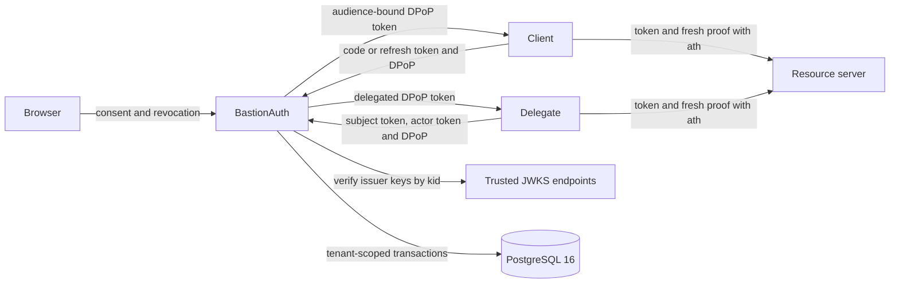

# BastionAuth

BastionAuth is a Go authorization service with S256 PKCE, delegated OAuth token exchange, and DPoP sender-constrained access tokens. Each deployment selects a tenant from server configuration. PostgreSQL policies enforce that tenant on every application transaction.



## Protocols

| Endpoint | Input and behavior |
| --- | --- |
| `GET /oauth/authorize` | Renders consent for an authenticated session. Requires `response_type=code`, an exact registered `redirect_uri`, registered `scope`, `state`, and S256 PKCE. Accepts optional `dpop_jkt` for code binding. |
| `POST /oauth/authorize` | Processes the rendered consent form. Checks the HTTPS origin and session-bound form integrity, then redirects with the original `state` and a single-use code or denial. Clients verify `state` against their initiating session. |
| `POST /oauth/token` | Accepts form-encoded authorization-code, rotating refresh-token, and RFC 8693 requests with a fresh `DPoP` header. Public clients send `client_id`. Confidential clients use `client_secret_basic`. |
| `POST /oauth/grant/revoke` | Accepts form-encoded `client_id` from the user’s session and same origin. Revokes all codes and refresh tokens for that client grant. |
| `GET /.well-known/jwks.json` | Serves the active public Ed25519 signing key. |

RFC 8693 requests use `urn:ietf:params:oauth:grant-type:token-exchange`, two access-token type identifiers (`urn:ietf:params:oauth:token-type:access_token`), and a configured `audience`. The client authenticates with its secret and presents an actor token naming that same client. The subject token must authorize that actor via `may_act`. Each requested scope must appear on both tokens and in the target policy. Unrecognized target, actor, or delegation fails with `access_denied`. Scope escalation fails with `invalid_scope`. An omitted `scope` requests the subject’s full scope and is still subject to the intersection. See the design RFC for the database and verification invariants. [RFC 001](rfcs/001-token-exchange-and-rls.md)

## Run

Use Go 1.25+, a C compiler for the PostgreSQL parser and race detector, and PostgreSQL 16. Apply migrations as a schema owner with `psql` in autocommit mode. The timeout settings and DDL in each file must run on the same connection. For a dedicated database:

```sh
psql "$MIGRATION_DATABASE_URL" -v ON_ERROR_STOP=1 \
  -f migrations/001_core.sql -f migrations/002_expiration_indexes.sql
openssl genpkey -algorithm ED25519 -out signing-key.pem
go run ./cmd/bastionauth config.json
```

Give the service’s `DATABASE_URL` role schema usage and table CRUD privileges. Use a separate, non-owner role with `NOSUPERUSER NOBYPASSRLS` and restrict its connection to the service. For a transaction-mode PgBouncer connection, use the service’s default pgx execution mode, which avoids named prepared statements. Terminate HTTPS at a trusted proxy and restrict access to the service listener. Configure ingress rate limits and keep service clocks synchronized.

Example `config.json`:

```json
{
  "Tenant": "north",
  "Origin": "https://auth.example.com",
  "Audience": "https://api.example.com",
  "Issuer": "https://auth.example.com",
  "KeyID": "signing-2026-01",
  "SigningKeyFile": "signing-key.pem",
  "Listen": "127.0.0.1:8080",
  "Clients": {
    "web": {
      "Redirects": ["https://web.example.com/callback"],
      "Scopes": ["inventory:read"]
    },
    "delegate": {
      "SecretDigest": "REPLACE_WITH_BASE64URL_SHA256_OF_A_HIGH_ENTROPY_CLIENT_SECRET"
    }
  },
  "Targets": {
    "https://inventory.example.com": ["inventory:read"]
  },
  "Sessions": {
    "Issuer": "https://login.example.com",
    "Audience": "bastion-consent",
    "JWKSURL": "https://login.example.com/jwks"
  },
  "Exchange": {
    "Issuer": "https://trust.example.com",
    "Audience": "bastion-exchange",
    "JWKSURL": "https://trust.example.com/jwks"
  }
}
```

An upstream identity service supplies the `__Host-bastion_session` cookie on the authorization origin with `Secure`, `HttpOnly`, `Path=/`, and a suitable SameSite policy. The cookie contains a signed `at+jwt` with the configured issuer, sole session audience, tenant, subject, and expiration. The exchange trust configuration accepts `at+jwt` assertions from its configured issuer and audience. Store signing keys and client secrets in a secret manager, use high-entropy confidential-client secrets, and give their unpadded base64url SHA-256 digests to BastionAuth. Schedule expired credential cleanup in tenant-scoped transactions using the `(tenant_id, expires_at)` index.

## Threat model and scope

- A leaked authorization code requires its verifier and exact registered redirect URI. A leaked DPoP-bound token requires the corresponding signing key and a fresh proof. Resource servers verify token claims, `cnf.jkt`, and `ath` using the public JWKS and a shared replay store. They enforce the resource’s audience and application scopes.
- Revocation and token rotation serialize on the same grant. Codes or refresh tokens from earlier generations fail with `invalid_grant` after revocation, including after re-consent. Already issued access tokens expire on their short TTL.
- Missing tenant settings fail closed under RLS. The control assumes the service controls the tenant setting and database role. A compromised application database credential can set tenant context, so the role and connection must remain private.
- Invalid proofs, replay, wrong issuer or audience, JWKS refresh failures, and unavailable state storage cause request failure. A valid cached JWKS remains usable until its cache TTL. Configure an upstream identity provider for interactive login and a resource server for application authorization. Dynamic registration, password grants, login UI, DPoP nonces, and online introspection are outside the service’s scope.

## Verify and benchmark

Set `DATABASE_URL` to a disposable PostgreSQL 16 instance with an integration-test role allowed to create schemas and roles. The integration test creates a temporary schema and authenticates queries as a restricted role. Without this variable, the protocol tests run against the in-memory store.

```sh
go test -race -v ./...
go run ./cmd/migrationlint ./migrations
go run ./benchmarks/run_bench.go -requests 4000 -workers 16
```

The benchmark uses a loopback HTTP server, real token signatures, a served JWKS, unique DPoP proofs, and the in-memory replay store. Throughput and latency come from the concurrent HTTP run. Allocations per operation come from Go’s `testing.Benchmark` and include both HTTP peers. [Measured results](benchmarks/RESULTS.md)
